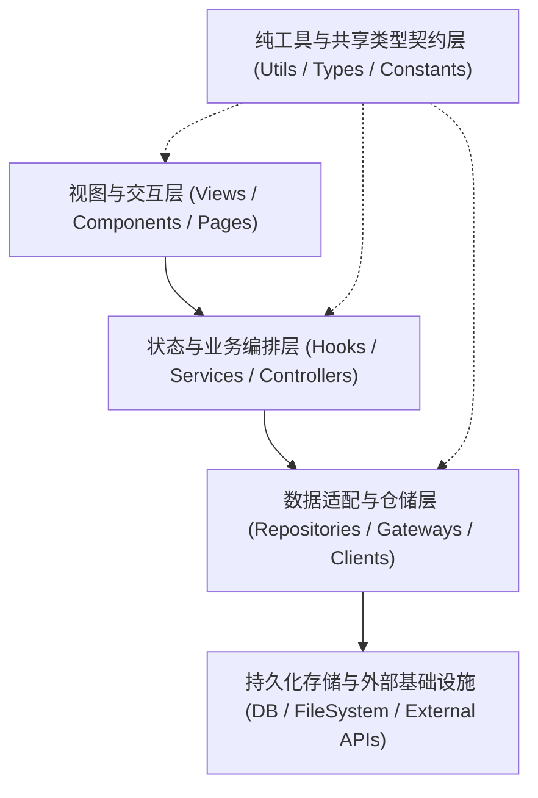

# 乐高模块级全局代码地图 (`CODE_MAP.md`)

> [!NOTE]
> **账本定位与维护铁律**：
> 本文件是当前项目的**「架构与代码空间唯一导航真源（Single Source of Truth for Code Topology）」**。
> - **多项目物理隔离铁律**：本文件必须且只能存放在**当前目标项目的 `<项目根目录>/memory/CODE_MAP.md`** 中！
> - **自动化同步机制**：可通过运行 `node ~/.gemini/config/plugins/agy-evo-os/scripts/auto-code-mapper.mjs --root "<项目根目录>" --output "<项目根目录>/memory/CODE_MAP.md"` 自动扫描项目全量源码树并无损刷新第三节 `AUTO-CODE-MAP` 锚点区块。

---

## 一、 架构分层总览与单向依赖法则（Architecture Layers）



---

## 二、 全局唯一真源文件表与模块职责映射示范（Single Source of Truth Registry）

| 真源类别 | 唯一权威文件路径（SSOT Path） | 管辖内容说明 | 派生/构建产物与同步关系 |
| :--- | :--- | :--- | :--- |
| **环境变量与全局配置** | `[待项目首次扫描填入]` | 端口、密钥、数据库连接与运行模式唯一配置入口 | 修改后需同步更新 `.env.example` 并重启服务 |
| **前后端共享类型契约** | `[待项目首次扫描填入]` | 核心业务实体 Schema、接口出入参 DTO 定义 | 修改后前后端调用方必须同步通过类型检查 |
| **数据库 Schema 与迁移** | `[待项目首次扫描填入]` | 数据表结构定义与无损迁移脚本 | 变更前必须先执行快照备份 |

| 模块路径 | 行数 | 核心职责 | 导出符号 | 上下游依赖与关联基因 |
| :--- | :--- | :--- | :--- | :--- |
| `[示例: src/client/hooks/useAuthSession.ts]` | `~140 行` | 前端登录会话状态管理与自动续期 | `useAuthSession`, `clearSession` | 依赖 `auth.api.ts`，关联 `FEAT-001`、`EVO-001` |

---

## 三、 模块职责与核心函数行号区间索引（Module & Symbol Index）

<!-- AUTO-CODE-MAP:START -->

# 🗺️ 项目全栈代码地图与符号行号索引 (Auto Code Map)

> **自动生成时间**: `2026-10-31T03:33:59.696Z`  
> **扫描项目根目录**: `~/.gemini/config/plugins/agy-evo-os`  
> **统计摘要**: 共扫描 **34** 个文本/源码文件，累计 **9566** 行代码

## 1. 目录拓扑结构树

```text
.
├── hooks/
│   └── hooks.json
├── mcp/
│   └── instructions.md
├── memory/
│   ├── sessions/
│   │   └── TEMPLATE_SESSION_MEMORY.md
│   ├── ARCHITECTURE_DECISIONS.md
│   ├── CODE_MAP.md
│   ├── CONVERSATION_INDEX.md
│   ├── EVOLUTION_LEDGER.md
│   ├── PRODUCT_PROGRESS.md
│   └── USER_PROFILE.md
├── scripts/
│   ├── auto-code-mapper.mjs
│   ├── code-graph-3d-generator.mjs
│   ├── cross-project-federation.mjs
│   ├── evo-memory-mcp-server.mjs
│   ├── evo-patrol-inspector.mjs
│   ├── federated-graph-3d-generator.mjs
│   ├── install-to-antigravity.sh
│   ├── memory-graph-engine.mjs
│   ├── memory-vector-tokenizer.mjs
│   ├── security-and-simplicity-audit.mjs
│   ├── session-memory-slicer.mjs
│   ├── snapshot-and-rollback.sh
│   ├── stop-hook-guardian.mjs
│   └── universal-preflight-gate.mjs
├── sidecars/
│   └── code_galaxy_3d/
│       ├── server.mjs
│       └── sidecar.json
├── skills/
│   ├── 01-intent-and-research/
│   │   └── SKILL.md
│   ├── 02-modular-refactor-and-map/
│   │   └── SKILL.md
│   ├── 03-fullstack-atomic-guardrails/
│   │   ├── references/
│   │   │   └── atomic-checklists.md
│   │   └── SKILL.md
│   ├── 04-qa-release-and-ops/
│   │   └── SKILL.md
│   └── 05-self-evolving-skill-mcp-forge/
│       └── SKILL.md
├── GEMINI.md
├── mcp_config.json
└── README_小白一键看懂与接入指南.md
```

## 2. 模块行数与体积分级总览

| 文件路径 | 类型 | 行数 | 模块体积状态 | 关键符号数量 |
| :--- | :--- | ---: | :--- | ---: |
| `hooks/hooks.json` | `.json` | 13 | 🟢 健康 (≤300行) | 0 |
| `mcp/instructions.md` | `.md` | 99 | 🟢 健康 (≤300行) | 0 |
| `memory/sessions/TEMPLATE_SESSION_MEMORY.md` | `.md` | 57 | 🟢 健康 (≤300行) | 0 |
| `memory/ARCHITECTURE_DECISIONS.md` | `.md` | 59 | 🟢 健康 (≤300行) | 0 |
| `memory/CODE_MAP.md` | `.md` | 321 | 🟡 预警 (301~499行，禁止继续塞入无关特性) | 0 |
| `memory/CONVERSATION_INDEX.md` | `.md` | 43 | 🟢 健康 (≤300行) | 0 |
| `memory/EVOLUTION_LEDGER.md` | `.md` | 569 | 🔴 超标 (≥500行，需乐高拆分或模式B渐进抽离) | 0 |
| `memory/PRODUCT_PROGRESS.md` | `.md` | 77 | 🟢 健康 (≤300行) | 0 |
| `memory/USER_PROFILE.md` | `.md` | 57 | 🟢 健康 (≤300行) | 0 |
| `scripts/auto-code-mapper.mjs` | `.mjs` | 434 | 🟡 预警 (301~499行，禁止继续塞入无关特性) | 11 |
| `scripts/code-graph-3d-generator.mjs` | `.mjs` | 523 | 🔴 超标 (≥500行，需乐高拆分或模式B渐进抽离) | 9 |
| `scripts/cross-project-federation.mjs` | `.mjs` | 597 | 🔴 超标 (≥500行，需乐高拆分或模式B渐进抽离) | 18 |
| `scripts/evo-memory-mcp-server.mjs` | `.mjs` | 536 | 🔴 超标 (≥500行，需乐高拆分或模式B渐进抽离) | 4 |
| `scripts/evo-patrol-inspector.mjs` | `.mjs` | 431 | 🟡 预警 (301~499行，禁止继续塞入无关特性) | 8 |
| `scripts/federated-graph-3d-generator.mjs` | `.mjs` | 594 | 🔴 超标 (≥500行，需乐高拆分或模式B渐进抽离) | 10 |
| `scripts/install-to-antigravity.sh` | `.sh` | 322 | 🟡 预警 (301~499行，禁止继续塞入无关特性) | 5 |
| `scripts/memory-graph-engine.mjs` | `.mjs` | 570 | 🔴 超标 (≥500行，需乐高拆分或模式B渐进抽离) | 9 |
| `scripts/memory-vector-tokenizer.mjs` | `.mjs` | 343 | 🟡 预警 (301~499行，禁止继续塞入无关特性) | 8 |
| `scripts/security-and-simplicity-audit.mjs` | `.mjs` | 588 | 🔴 超标 (≥500行，需乐高拆分或模式B渐进抽离) | 5 |
| `scripts/session-memory-slicer.mjs` | `.mjs` | 228 | 🟢 健康 (≤300行) | 5 |
| `scripts/snapshot-and-rollback.sh` | `.sh` | 241 | 🟢 健康 (≤300行) | 4 |
| `scripts/stop-hook-guardian.mjs` | `.mjs` | 438 | 🟡 预警 (301~499行，禁止继续塞入无关特性) | 12 |
| `scripts/universal-preflight-gate.mjs` | `.mjs` | 534 | 🔴 超标 (≥500行，需乐高拆分或模式B渐进抽离) | 16 |
| `sidecars/code_galaxy_3d/server.mjs` | `.mjs` | 88 | 🟢 健康 (≤300行) | 1 |
| `sidecars/code_galaxy_3d/sidecar.json` | `.json` | 21 | 🟢 健康 (≤300行) | 0 |
| `skills/01-intent-and-research/SKILL.md` | `.md` | 202 | 🟢 健康 (≤300行) | 0 |
| `skills/02-modular-refactor-and-map/SKILL.md` | `.md` | 222 | 🟢 健康 (≤300行) | 0 |
| `skills/03-fullstack-atomic-guardrails/references/atomic-checklists.md` | `.md` | 154 | 🟢 健康 (≤300行) | 0 |
| `skills/03-fullstack-atomic-guardrails/SKILL.md` | `.md` | 157 | 🟢 健康 (≤300行) | 0 |
| `skills/04-qa-release-and-ops/SKILL.md` | `.md` | 441 | 🟡 预警 (301~499行，禁止继续塞入无关特性) | 0 |
| `skills/05-self-evolving-skill-mcp-forge/SKILL.md` | `.md` | 217 | 🟢 健康 (≤300行) | 0 |
| `GEMINI.md` | `.md` | 281 | 🟢 健康 (≤300行) | 0 |
| `mcp_config.json` | `.json` | 11 | 🟢 健康 (≤300行) | 0 |
| `README_小白一键看懂与接入指南.md` | `.md` | 98 | 🟢 健康 (≤300行) | 0 |

## 3. 核心源码模块符号与行号精准索引

### 📄 `scripts/auto-code-mapper.mjs` (434 行)
- `L42` **[function]** `shouldIgnoreDirName`
- `L71` **[function]** `parseArgs`
- `L110` **[function]** `scanDirectoryTree`
- `L115` **[function]** `walk`
- `L183` **[function]** `extractJsTsSymbols`
- `L214` **[function]** `extractPythonSymbols`
- `L242` **[function]** `extractHtmlSymbols`
- `L270` **[function]** `extractShellSymbols`
- `L285` **[function]** `analyzeFile`
- `L334` **[function]** `renderMarkdownReport`
- `L378` **[function]** `main`

### 📄 `scripts/code-graph-3d-generator.mjs` (523 行)
- `L13` **[export function]** `buildGraphAndBlastRadius`
- `L135` **[function]** `dfsCycle`
- `L241` **[function]** `renderGraphReportMd`
- `L280` **[function]** `render3dGalaxyHtml`
- `L350` **[function]** `resize`
- `L377` **[function]** `stepPhysics`
- `L401` **[function]** `selectNode`
- `L429` **[function]** `project3D`
- `L439` **[function]** `render`

### 📄 `scripts/cross-project-federation.mjs` (597 行)
- `L22` **[export function]** `readSwarmRegistry`
- `L28` **[function]** `updateSwarmRegistry`
- `L48` **[export function]** `normalizePathInput`
- `L55` **[export function]** `isContainerOrMotherDir`
- `L64` **[export function]** `hasRealProjectFiles`
- `L68` **[export function]** `resolveCanonicalProjectRoot`
- `L79` **[export function]** `inferProjectRoleTag`
- `L89` **[export function]** `discoverLanguageServerConfig`
- `L109` **[function]** `probeLsPort`
- `L114` **[export function]** `callLanguageServerRpc`
- `L125` **[export function]** `inspectConversationTranscript`
- `L177` **[export function]** `discoverAntigravityProjectsAndConversations`
- `L288` **[export function]** `appendCrossProjectMemory`
- `L367` **[export function]** `dispatchTaskToConversation`
- `L393` **[const fn]** `sameCid`
- `L475` **[export function]** `swarmSpawnOrRouteByName`
- `L530` **[export function]** `swarmReportToCommander`
- `L572` **[export function]** `getSwarmStatusBoard`

### 📄 `scripts/evo-memory-mcp-server.mjs` (536 行)
- `L35` **[function]** `ensureProjectMemoryInitialized`
- `L245` **[function]** `applyProfileFieldsToFile`
- `L255` **[function]** `updateUserProfileAcrossScopes`
- `L269` **[function]** `handleRpcRequest`

### 📄 `scripts/evo-patrol-inspector.mjs` (431 行)
- `L25` **[function]** `parseArgs`
- `L50` **[function]** `loadWatermark`
- `L59` **[function]** `saveWatermark`
- `L70` **[function]** `checkMotherTemplatePurity`
- `L106` **[function]** `scanRecentConversations`
- `L206` **[function]** `checkAndHealInitializedProjects`
- `L353` **[function]** `checkPluginAndMcpHealth`
- `L410` **[function]** `main`

### 📄 `scripts/federated-graph-3d-generator.mjs` (594 行)
- `L15` **[export function]** `buildFederated3dGraph`
- `L139` **[const fn]** `addBridge`
- `L157` **[const fn]** `findNodeInGalaxy`
- `L279` **[function]** `renderFederatedReportMd`
- `L343` **[function]** `renderFederated3dHtml`
- `L419` **[function]** `resize`
- `L445` **[function]** `updateTabStyles`
- `L484` **[function]** `selectNode`
- `L502` **[function]** `project3D`
- `L509` **[function]** `render`

### 📄 `scripts/install-to-antigravity.sh` (322 行)
- `L32` **[sh-fn]** `call_lsrpc_if_available`
- `L44` **[sh-fn]** `install_global_plugin`
- `L164` **[sh-fn]** `toggle_global_plugin`
- `L191` **[sh-fn]** `install_to_single_project`
- `L246` **[sh-fn]** `show_status`

### 📄 `scripts/memory-graph-engine.mjs` (570 行)
- `L15` **[export function]** `openMemoryDatabase`
- `L60` **[export function]** `collectProjectFiles`
- `L88` **[const fn]** `walkCode`
- `L118` **[export function]** `syncIncrementalIndex`
- `L255` **[export function]** `funnelHybridRecall`
- `L379` **[function]** `readPendingCrossInboxSummary`
- `L405` **[export function]** `recallForTask`
- `L470` **[function]** `runStressBenchmark`
- `L542` **[function]** `main`

### 📄 `scripts/memory-vector-tokenizer.mjs` (343 行)
- `L17` **[export const]** `VECTOR_DIM`
- `L32` **[export function]** `tokenizeForSearch`
- `L69` **[export function]** `encodeFloat32Vector`
- `L100` **[export function]** `cosineSimFloat32`
- `L107` **[export function]** `extractEntitiesFromText`
- `L127` **[export function]** `parseFileToNodesAndEdges`
- `L131` **[const fn]** `pushNode`
- `L327` **[export function]** `readUserProfile`

### 📄 `scripts/security-and-simplicity-audit.mjs` (588 行)
- `L33` **[function]** `collectCodeFiles`
- `L76` **[export function]** `runSecurityAndSimplicityAudit`
- `L215` **[const fn]** `splitTopLevelCommas`
- `L239` **[const fn]** `stripTopLevelTypeAndDefault`
- `L467` **[export function]** `recordRsiExperiment`

### 📄 `scripts/session-memory-slicer.mjs` (228 行)
- `L24` **[function]** `parseArgs`
- `L69` **[function]** `formatDateParts`
- `L81` **[function]** `sanitizeSlug`
- `L90` **[function]** `getNextSequenceNumber`
- `L108` **[function]** `main`

### 📄 `scripts/snapshot-and-rollback.sh` (241 行)
- `L42` **[sh-fn]** `print_usage`
- `L58` **[sh-fn]** `cmd_backup`
- `L110` **[sh-fn]** `cmd_rollback`
- `L174` **[sh-fn]** `cmd_list`

### 📄 `scripts/stop-hook-guardian.mjs` (438 行)
- `L31` **[function]** `readHookInput`
- `L79` **[function]** `isContainerDir`
- `L92` **[function]** `isEvoEnabledProject`
- `L101` **[function]** `findEvoProjectAncestor`
- `L118` **[function]** `resolveProjectFromTranscript`
- `L167` **[function]** `getLatestProjectActivityMtime`
- `L169` **[const fn]** `checkStat`
- `L209` **[function]** `resolveProjectRoot`
- `L293` **[function]** `getSessionStateFile`
- `L298` **[function]** `readBlockCount`
- `L308` **[function]** `writeBlockCount`
- `L320` **[function]** `main`

### 📄 `scripts/universal-preflight-gate.mjs` (534 行)
- `L35` **[function]** `stripJsoncCommentsAndTrailingCommas`
- `L66` **[function]** `parseArgs`
- `L89` **[function]** `walkProjectFiles`
- `L92` **[function]** `walk`
- `L127` **[function]** `stripEsmSyntaxPreservingLines`
- `L128` **[const fn]** `blankKeepNewlines`
- `L138` **[function]** `validateInlineScriptAst`
- `L140` **[const fn]** `compileWithVm`
- `L167` **[function]** `checkJsSyntaxFast`
- `L188` **[function]** `runCheck1SyntaxAndAst`
- `L305` **[function]** `runCheck2ModuleVolumeRadar`
- `L328` **[function]** `runCheck3AntiPatternScan`
- `L390` **[function]** `runCheck4MemoryLedgerCheck`
- `L426` **[function]** `runCheck5HealthProbe`
- `L460` **[function]** `printHumanReport`
- `L509` **[function]** `main`

### 📄 `sidecars/code_galaxy_3d/server.mjs` (88 行)
- `L34` **[function]** `getHtmlContent`


<!-- AUTO-CODE-MAP:END -->

---

## 四、 唯一真源与派生构建映射表（防阴阳副本护栏）

| 派生/构建产物路径 (Derived Path) | 唯一真源路径 (Single Source of Truth) | 自动同步/构建说明 | 状态策略 |
| :--- | :--- | :--- | :--- |
| `<项目根目录>/memory/.memory-store/memory.sqlite` | `<项目根目录>/memory/*.md` & 项目源码 | 通过 `memory_recall_for_task`（自动增量同步）或 `memory_rebuild_index` 生成 | 严禁直接手改二进制库，修改 `.md` 真源后自动增量同步 |

---

## 五、 待拆分历史大文件与技术债追踪表（Monolith Refactoring Tracker — 模式 B 生效）

> [!WARNING]
> **模式 B（童子军渐进抽离法则）防死循环豁免说明**：
> 下表登记的存量历史大文件受 **「行数只减不增（Strictly Non-Increasing Line Count）」** 规则保护。后续每次修改触及其中某个文件时，将该次涉及的业务子块抽离为 $\le 300$ 行的独立乐高子模块，确保原大文件行数只减不增，严禁因存量老文件本身超过 500 行而强行触发全量重写死循环。

| 追踪编号 | 超标文件路径 | 当前行数 | 预警等级 | 臃肿根因分析（混杂了哪些不同职责？） | 模式 B 渐进抽离计划（触及时优先拆出的独立子模块） | 状态 |
| :--- | :--- | :---: | :---: | :--- | :--- | :---: |
| `SPLIT-001` | `[暂无超标文件（全部模块 ≤ 500 行）]` | `-` | `🟢 健康` | `-` | `-` | `[x] 达标` |
