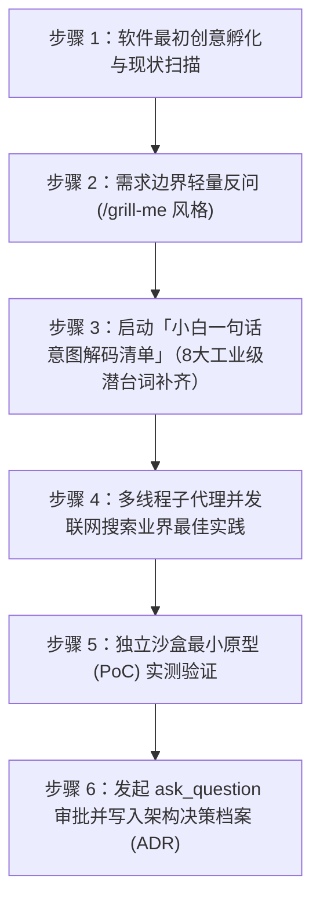

# 01 - 意图解码与多线程并发联网科研标准作业程序 (Intent Decoding & Parallel Research SOP)

> **核心使命**：将用户简短、模糊甚至外行的“一句话想法”，转化为边界严密、技术领先、经过独立沙盒实测验证的工业级可执行工程蓝图。严禁直接拿着模糊需求凭记忆盲目写业务代码。

---

## 全局原子级执行流水线（6 步闭环）



---

## 步骤 1：软件最初创意孵化与工作区全息扫描

在收到用户的初始请求后，严禁立刻开始堆砌业务代码，必须先在 **30 秒内** 完成环境与背景摸底：

1. **区分项目形态**：
   - **形态 A（从 0 到 1 全新孵化）**：检查目标目录是否为空，确认用户期望的产品形态（Web全栈应用、桌面端、移动端、命令行工具或自动化后台服务）及运行环境（操作系统、已安装的语言运行时如 Node/Python/Go/Rust 等）。
   - **形态 B（存量项目新增需求或改造）**：优先读取 `memory/PRODUCT_PROGRESS.md`、`memory/CODE_MAP.md` 与 `memory/ARCHITECTURE_DECISIONS.md`，摸清现有技术栈、模块边界与历史决策，避免引入与现有架构冲突的重复轮子。
2. **识别核心痛点**：用一句话提炼用户真正想要解决的**业务目标**（例如：用户说“我想搞个表格上传页面”，真实业务目标是“让非技术人员能把线下 Excel 数据零出错地导入系统并随时查看修改”）。

---

## 步骤 2：需求边界反问与对齐（`/grill-me` 极简大白话交互）

当用户的初始想法存在关键业务分支或体验取舍时，主动采用 `/grill-me` 访谈思维，但**必须严格遵守「大白话、少而精、带推荐项」三大铁律**：

### 2.1 反问触发条件与克制原则
- **免反问直通场景**：如果只是技术实现细节（如“用什么状态管理库”、“数据库建什么索引”、“怎么防并发冲突”），**严禁拿去烦用户**！这些全部由智能体在步骤 3 和步骤 4 中自行按顶级工业标准拍板解决。
- **必反问对齐场景**：仅当涉及**核心产品形态、用户可见的业务规则分支、数据留存范围或外部账号授权**时，才调用 `ask_question` 向用户确认。每次提问最多不超过 3 个高价值选择题，且第一个选项必须标明 `(Recommended)`。

### 2.2 标准大白话反问模板（调用 `ask_question`）
```json
{
  "questions": [
    {
      "question": "为了让这个功能用起来最顺手，关于【核心使用场景/数据保存方式】，您更倾向于哪种方案？",
      "options": [
        "(Recommended) 方案一：本地+云端自动同步（断网也能用，换设备数据不丢失，最省心）",
        "方案二：纯本机离线存储（数据完全留在当前电脑里，启动最快，无需配置账号）",
        "方案三：仅作为临时处理工具（用完即走，直接导出结果文件，不在系统留存历史记录）"
      ],
      "is_multi_select": false
    }
  ]
}
```

---

## 步骤 3：小白一句话意图解码清单（8 大工业级潜台词自动补齐）

用户选定方向后，智能体必须在内部将用户的简单描述放入**「意图解码器」**，逐项对照并补齐以下 8 大工业级潜台词。**任何一项未在设计中落实，严禁进入编码阶段**：

### 3.1 意图解码自检核对表（内部强制执行）

| 潜台词编号 | 解码维度 | 自动补齐的工业级工程需求清单 |
| :--- | :--- | :--- |
| **潜台词 01** | **全边界输入防呆** | - [ ] 所有表单/参数是否具备前后端双重格式与类型校验？<br>- [ ] 是否处理了空字符串、纯空格、超长输入、特殊符号/Emoji、负数与零值边界？<br>- [ ] 提交按钮是否具备防抖（Debounce）与请求进行中禁用（Disabled）锁，防止连点产生重复脏数据？ |
| **潜台词 02** | **UI 五态完整性** | - [ ] **加载态**：首屏及异步操作是否有骨架屏或清晰 Loading 提示？<br>- [ ] **空数据态**：列表或结果为空时，是否有通俗提示语及“立即新建/重置筛选”快捷引导按钮？<br>- [ ] **正常态**：排版是否对齐、长文本是否优雅截断或换行、响应式布局是否自适应？<br>- [ ] **局部错误态**：接口失败时是否在对应区域展示大白话原因及“点击重试”按钮，而非整页崩溃？<br>- [ ] **成功反馈态**：增删改保存后是否有明确的 Toast 提示或视觉高亮反馈？ |
| **潜台词 03** | **运行态热联动** | - [ ] 修改配置项、状态开关或基础字典后，正在运行的后台任务、关联图表、导航栏徽标是否无需刷新整页即可实时同步更新？ |
| **潜台词 04** | **四层缓存与孤儿锁清理** | - [ ] 写入/更新数据后，是否主动刷新或失效了前端状态缓存、HTTP缓存、服务端内存缓存与查询缓存？<br>- [ ] 异步任务、文件读写或数据库事务在超时、报错或用户中途关闭时，是否在 `finally` 块中100%释放了锁、临时文件与子进程？ |
| **潜台词 05** | **局部无感刷新** | - [ ] 列表单行编辑、状态切换、删除或新增后，是否采用局部状态更新或无感重取，完整保留用户当前的滚动条位置、搜索词与分页页码？ |
| **潜台词 06** | **老数据默认兜底** | - [ ] 新增的数据字段或配置项，在读取老版本存量数据时是否有安全的默认值兜底（如 `data?.newField ?? defaultVal`），确保绝不抛出 `Cannot read properties of undefined`？ |
| **潜台词 07** | **零丢数平滑迁移** | - [ ] 涉及存储结构调整时，是否先自动生成了备份快照？是否采用向后兼容的扩列/转换策略，确保已有用户数据一字不丢？ |
| **潜台词 08** | **失败自动回滚** | - [ ] 多步关联操作（如“扣减额度 + 生成记录 + 写入文件”）如果卡在第 3 步失败，前两步是否能通过事务或补偿逻辑自动退回原状？ |

---

## 步骤 4：多线程子代理并发联网搜索业界最佳实践

当任务涉及技术选型、第三方 SDK/API 集成、复杂算法实现或非显而易见的架构设计时，**严禁仅凭模型训练记忆直接拍脑袋写代码**（防止使用已废弃 API 或次优方案），必须启动主从并发科研机制：

### 4.1 派生并发科研子代理（`invoke_subagent`）
- **主代理动作**：继续留在主工作区梳理目录结构、搭建基础模块接口骨架或准备测试数据集。
- **子代理动作**：通过 `invoke_subagent` 启动 1~3 个并行子代理（只读检索用 `TypeName: "research"`，需跑代码实验用 `TypeName: "self"` 并配置隔离工作区），同步调用 `search_web` 或官方文档检索工具。

### 4.2 并发科研子代理派单提示词模板
调用 `invoke_subagent` 时，必须向子代理下达明确的检索维度与交付格式要求：
```markdown
【任务角色】：前沿技术方案与最佳实践联网调研员
【调研课题】：针对「<具体业务场景或技术难题>」，联网检索当前业界最新（优先近1~2年内）的稳定解决方案。
【强制执行动作】：
1. 使用 `search_web` 及官方文档工具检索至少 2~3 种主流实现方案或库；
2. 严禁采信已标记为 Deprecated（废弃）的旧版写法，核对当前最新稳定版（Stable）的 API 签名；
3. 重点排查各方案在跨平台兼容性、内存占用、并发安全及错误处理上的已知坑点。
【返回报告格式】：
- 候选方案对比表（方案名称、最新稳定版本、核心优缺点、维护活跃度）；
- 唯一首选推荐方案及推荐理由；
- 官方最新标准调用代码示例（含完整异常处理）。
```

### 4.3 前沿/黑科技开源项目去伪存真审查清单 (Open-Source Authenticity & Skepticism Check)

当用户提出引入、接入或复现号称具备“颠覆性效果”（如 WiFi 隔墙人体 3D 姿态捕捉、单目摄像头超声成像等）的前沿开源项目时，**严禁盲目下载代码、安装沉重依赖直接调通**。在写代码和配置环境前，必须先执行去伪存真三步审查：

1. **源码内核真实性检索 (Source Integrity Check)**：
   - 检索代码库中是否存在 `mock`、`fake`、`simulation`、`demo_replay`、`preset_poses` 或固定序列循环播放逻辑；
   - 检查核心算法与权重：宣传视频中展示的酷炫效果是否是由写死的静态动画驱动？核心算法模型与预训练权重是否真实可用？
2. **社区与技术论坛口碑交叉求证 (Community Skepticism Search)**：
   - 使用 `search_web` 搜索 `[项目名/仓库名] + (fake OR scam OR issue OR accuracy OR 噱头 OR 真实效果 OR 论坛)`；
   - 查阅 GitHub Issues / Reddit / V2EX / 知乎等真实开发者反馈，核实真实精度与硬件门槛（例如：宣传 3D 动作捕捉，实测准确率仅 3% 且主要靠演示动画包装）；
3. **技术现状坦诚预警 (Transparent Skepticism Alert)**：
   - 一旦发现项目实际代码与宣传存在巨大落差、或仅为商业营销噱头，必须在第一时间向用户如实预警并展示代码实证，供用户及时止损决策，严禁报喜不报忧或浪费算力陪跑假项目。

---

## 步骤 4.5：主代理对子代理交付物的强制通读与防打转交叉审查（Mandatory Main-Agent Cross-Audit）

> [!CAUTION]
> **主代理铁律：严禁盲目采信子代理汇报摘要！**
> 无论派出的是只读调研子代理（`research`）还是并行编写代码/文档的执行子代理（`self`），当子代理完成工作返回消息后，主代理在合入主工程或向用户汇报前，**必须亲自执行以下 4 项审查与验证**：

1. **逐文件通读原文（100% Full-Text Read）**：
   - 调用 `read_file` 通篇阅读子代理产出的所有代码文件、配置文件、脚本与文档，严禁只看子代理返回的对话总结。
   - 检查是否存在未实现的空壳函数、虚构的 API 方法名或遗漏的边界处理。
2. **跨子代理关联性与路径/契约对齐核查（Cross-Subagent Consistency Check）**：
   - 当派出 ≥ 2 个子代理并行作业时，由于子代理之间存在独立上下文隔离，极易出现“A 代理引用的文件路径/脚本名/函数签名与 B 代理实际创建的名称不一致”。
   - 主代理必须逐一核对所有跨文件引用路径、目录名、导入导出符号、环境变量名与阈值常量，发现不一致立即亲手修平。
3. **防原地打转与死锁推演（Anti-Spinning & Circular Trap Check）**：
   - 审查子代理编写的业务逻辑、守护钩子（Hooks）、状态机流转或门禁规则，排查是否存在“条件 A 等待条件 B，条件 B 又依赖条件 A”的循环依赖或内部死锁。
4. **主代理亲手实测验真（Hands-On Execution Verification）**：
   - 主代理必须亲自运行验证命令（如 `node scripts/universal-preflight-gate.mjs`、构建测试或沙盒脚本），确认退出码为 `0` 且无隐性报错后，方可进入下一步或向用户汇报。

---

## 步骤 5：独立沙盒最小原型（PoC）实测验证

子代理返回联网调研结论后，**严禁直接将未经验证的网贴代码或新库逻辑塞进主工程**，必须先过独立沙盒实测关：

1. **建立隔离沙盒目录**：
   - 在临时沙盒路径（如对话专属 `<appDataDir>/brain/<conversation-id>/scratch/poc-<feature>/` 或独立分支工作区）创建最小验证脚本。
2. **编写并运行最小可复现原型（Minimal PoC）**：
   - 针对核心算法、外部接口调用、数据转换或并发锁逻辑，编写独立可执行的小脚本。
   - **真机跑通 3 类用例**：
     - ① 正常标准输入（验证核心功能跑通）；
     - ② 极端/空值/超长边界输入（验证防呆不崩）；
     - ③ 模拟异常/超时中断（验证资源与锁能正常释放）。
3. **清理沙盒与提炼纯血代码**：
   - 确认沙盒运行退出码为 `0` 且输出完全符合预期后，将验证通过的核心逻辑按 [`skills/02-modular-refactor-and-map/SKILL.md`](file://~/.gemini/config/plugins/agy-evo-os/skills/02-modular-refactor-and-map/SKILL.md) 的乐高模块规范，干净地提炼并合入主工程。
   - 若沙盒实测发现首选方案存在暗坑，立即切换至候选方案二重新沙盒验证；若连续 2 轮验证受阻，按 [`skills/04-qa-release-and-ops/SKILL.md`](file://~/.gemini/config/plugins/agy-evo-os/skills/04-qa-release-and-ops/SKILL.md) 触发诚实熔断。

---

## 步骤 6：发起审批并写入架构决策档案（ADR）

当意图解码、联网调研与沙盒实测全部通过后，必须将本次关键技术决策沉淀至当前目标项目的活体记忆档案 `<TARGET_PROJECT_ROOT>/memory/ARCHITECTURE_DECISIONS.md`（若同时明确了产品里程碑，一并准备更新 `<TARGET_PROJECT_ROOT>/memory/PRODUCT_PROGRESS.md`，严禁修改 `universal-fullstack-evo-os` 母版目录）。

### 6.1 强制前置审批与单次合并防打扰规则（遵守核心原则五）
- **在调用 `write_file` 或 `edit_file` 修改 `memory/ARCHITECTURE_DECISIONS.md` 之前，必须先调用 `ask_question` 向用户弹窗请求批准！**
- **防连环弹窗铁律**：若本次任务只需在收尾时一并记录 ADR、代码地图与产品进度，可将其合并至任务收工前的**「单次合并记忆审批弹窗」**中一次性确认；若属于动工前的重大技术路线抉择，则在动工前弹窗拍板一次即可。若用户点击“暂不写入/跳过”，立即继续主线或正常收工，严禁反复追问。

#### 审批提问标准话术示例：
```json
{
  "questions": [
    {
      "question": "我已经完成了需求细节补齐、最新技术方案联网对比以及独立沙盒实测验证。准备将本次【技术选型与架构设计方案】记录到项目的架构决策档案（memory/ARCHITECTURE_DECISIONS.md）中，方便后续随时查阅和回溯。是否同意写入？",
      "options": [
        "(Recommended) 同意写入架构决策档案并开始正式开发",
        "暂不写入档案，直接开始正式开发",
        "我想先调整一下方案细节"
      ],
      "is_multi_select": false
    }
  ]
}
```

### 6.2 `memory/ARCHITECTURE_DECISIONS.md` 标准写入条目模板
获得用户点击同意后，按以下工业级 ADR 模板追加记录：

```markdown
## ADR-[编号]：[决策标题，例如：批量数据导入解析引擎与事务回滚方案]
- **决策日期**：YYYY-MM-DD
- **状态**：已采纳并经沙盒实测通过 (Verified in Sandbox)
- **业务背景与小白意图解码**：
  - 用户原始诉求：[记录用户的一句话原始需求]
  - 自动补齐的 8 大潜台词要点：[简述输入防呆、五态UI、热联动、缓存/锁清理、局部刷新、老数据兜底、零丢数迁移、失败回滚的具体落点]
- **多线程联网调研对比**：
  | 候选方案 | 核心优势 | 潜在风险/劣势 | 淘汰/采纳结论 |
  | :--- | :--- | :--- | :--- |
  | 方案 A（采纳） | [优势说明] | [已知边界与规避措施] | **最终采纳** |
  | 方案 B（备选） | [优势说明] | [淘汰原因] | 留作备选 |
- **独立沙盒实测结论 (PoC Verification)**：
  - 验证脚本位置与测试场景：[简述正常态、边界态、异常中断态实测结果与耗时数据]
- **回滚与应急预案**：
  - 若未来生产环境出现极端异常，可通过 [具体回退命令或配置开关] 在 10 秒内无损切换回退。
```
