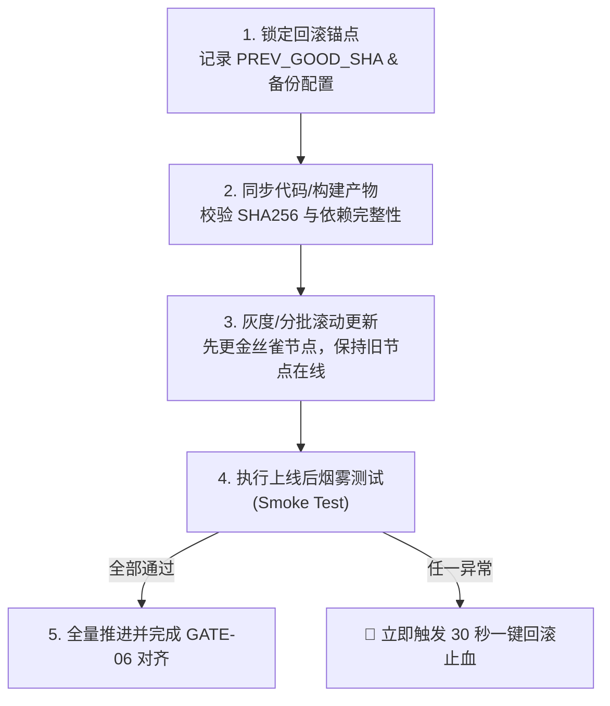

# 全链路真机质检门禁、发布运营与诚实熔断标准作业程序（QA, Release & Ops SOP）

> [!IMPORTANT]
> **核心铁律：未经真机运行态实测的改动视同未完成，严禁一切形式的“假验证”！**
> 绝不允许仅凭“代码看着没问题”、“静态语法通过”或“单测 Mock 绿灯”就向用户宣称交付完成。所有代码改动、配置变更与架构演进，必须严格按序通过 **GATE-01 至 GATE-06 六道递进式真机验收门禁**；任何一道门禁失败，立即阻断后续流程并退回修复。若触发熔断阈值，必须立即停止盲目试错，执行诚实熔断协议。

---

## 模块一：六道递进式真机验收门禁（GATE-01 ~ GATE-06，严禁假验证）

门禁采用**串行递进、一票否决**机制。必须严格按照 `GATE-01 -> GATE-02 -> GATE-03 -> GATE-04 -> GATE-05 -> GATE-06` 的顺序逐级通关，留存终端真实输出与指标证据。


### GATE-01：静态语法与 AST 编译关（Static Syntax & AST Compilation Gate）

**验收目标**：确保后端源码、自动化脚本、配置文件以及前端 HTML 内联 `<script>` 块的抽象语法树（AST）零语法错误、零未定义引用、零合并冲突残留标记。

**严禁假验证行为**：
- 严禁只检查独立 `.js` / `.py` 文件而忽略 `.html` / `.vue` / 模板文件中的内联 `<script>` 脚本。
- 严禁忽略 JSON / YAML / TOML 配置文件的尾随逗号或缩进错误。

**强制核验动作与通用脚本**：
1. **冲突标记与非法字符扫描**：全仓扫描 `<<<<<<<`、`=======`、`>>>>>>>` 确保零冲突残留。
2. **安全边界、死代码与虚假测试断言联合审计（v3.0 新增）**：运行 `node scripts/security-and-simplicity-audit.mjs --root <PROJECT_ROOT>`（或调用 MCP `security_simplicity_audit`），拦截 `expect(true).toBe(true)` 空壳假测试（`TEST-01`）、遗留 `.only()` 跳测（`TEST-02`）与安全高危项。
3. **后端与脚本 AST 校验（含 TS/TSX/JSX 与 `tsc --noEmit`）**：
   - Python：`python3 -m py_compile <file>` 或 `ruff check <dir>`
   - TypeScript / JavaScript：`npx tsc --noEmit` 或 `node --check <file>`
   - Go / Rust：`go vet ./...` / `cargo check`
   - Shell 脚本：`bash -n <script.sh>`
3. **HTML 内联 `<script>` AST 抽取校验**（针对含内联脚本的页面模板）：
   ```bash
   python3 -c '
   import sys, re, subprocess, tempfile, pathlib
   for html_path in pathlib.Path(".").rglob("*.html"):
       content = html_path.read_text(encoding="utf-8", errors="ignore")
       blocks = re.findall(r"<script(?![^>]*src=)[^>]*>(.*?)</script>", content, re.S | re.I)
       for idx, code in enumerate(blocks):
           if not code.strip(): continue
           with tempfile.NamedTemporaryFile("w", suffix=".js", delete=False) as f:
               f.write(code)
               tmp_name = f.name
           res = subprocess.run(["node", "--check", tmp_name], capture_output=True, text=True)
           pathlib.Path(tmp_name).unlink(missing_ok=True)
           if res.returncode != 0:
               print(f"[GATE-01 FAILED] {html_path} 内联 script #{idx+1} 语法错误:\n{res.stderr}")
               sys.exit(1)
   print("[GATE-01 PASSED] 所有 HTML 内联 script AST 校验零错误")
   '
   ```

**通关判据**：所有编译与 AST 检查返回码 `exit_code === 0`，零 `SyntaxError`。

---

### GATE-02：进程重启与运行态生效关（Process Restart & Runtime Activation Gate）

**验收目标**：修改后端代码、环境变量或服务配置后，必须重启目标服务进程，并核对**新进程 PID 更新**、**进程启动时间戳更新**以及 **`/health` 探针版本指纹生效**，彻底杜绝“改了磁盘文件但旧进程仍在内存中运行”的假生效现象。

**强制核验动作与通用脚本**：
1. **记录重启前状态**：采集当前监听端口的旧 PID 与启动时间：`OLD_PID=$(lsof -ti :<PORT> || true)`。
2. **优雅重启与孤儿进程清理**：停止旧服务，确认端口彻底释放后拉起新进程（或通过 `systemd` / `supervisor` / `pm2` / `docker compose up -d --build` 重启）。
3. **核验 PID 更新与存活稳定性**：
   ```bash
   NEW_PID=$(lsof -ti :<PORT>)
   if [ -z "$NEW_PID" ] || [ "$NEW_PID" = "$OLD_PID" ]; then
       echo "[GATE-02 FAILED] 进程未成功更新! OLD_PID=$OLD_PID, NEW_PID=$NEW_PID"
       exit 1
   fi
   sleep 2
   kill -0 "$NEW_PID" && echo "[GATE-02 PASSED] 新进程稳定存活 PID=$NEW_PID"
   ```
4. **核验 `/health` 探针运行态指纹**：请求 `GET /health`（或 `/api/health`），断言返回 `HTTP 200`，且响应体中的 `version` / `git_sha` / `uptime_sec` 证明当前运行的是最新代码（例如 `uptime_sec < 30`）。

**通关判据**：`NEW_PID !== OLD_PID`、等待 2 秒后进程未闪退、`/health` 返回 `200 OK` 且版本指纹与当前最新提交一致。

---

### GATE-03：接口契约与红队边界关（API Contract & Red-Team Boundary Gate）

**验收目标**：对新增或修改的 API 端点进行真实 HTTP 调用，不仅验证正常路径（Happy Path），还必须以红队视角注入畸形负载、越权凭证与并发冲突请求，确保服务具备完备的防御性校验，**严禁出现任何未捕获异常导致的 `HTTP 500`**。

**强制测试矩阵（五维状态码断言）**：

| 验收维度 | 构造输入场景 | 期望状态码 | 绝不允许出现 |
| :--- | :--- | :--- | :--- |
| **正常契约（Happy Path）** | 合法 Token + 完整合规业务参数 | `200 OK` / `201 Created` | 响应结构缺失关键字段、返回假空值 |
| **畸形参数（Malformed Input）** | 缺失必填项、类型错乱（字符串传给数字）、超长字符、空 JSON `{}`、SQL/XSS 特殊字符 | `400 Bad Request` / `422 Unprocessable Entity` | `500 Internal Server Error` 或崩溃退出 |
| **未授权访问（Unauthenticated）** | 不带 `Authorization` Header、携带伪造/过期 Token | `401 Unauthorized` | `200 OK`（裸奔）或 `500` |
| **越权拦截（Forbidden / IDOR）** | 普通角色访问管理员接口、尝试读取/修改其他租户/用户的资源 ID | `403 Forbidden` / `404 Not Found` | `200 OK`（越权泄露）或 `500` |
| **并发与幂等冲突（Conflict）** | 重复提交唯一键、并发扣减/状态机非法跃迁、携带旧版本号更新 | `409 Conflict` / `429 Too Many Requests` | 脏写覆盖、死锁超时或 `500` |

**通关判据**：全部五类测试用例返回符合预期的 2xx/4xx 状态码与标准错误 JSON 结构，全过程 **`HTTP 500 计数 === 0`**，后端错误日志无未捕获 StackTrace。

---

### GATE-04：真实无头浏览器 E2E 交互关（Real Headless Browser E2E Gate）

**验收目标**：严禁用 `curl` 请求 HTML 源码或 `grep` 关键字来代替前端测试！必须启动真实的无头浏览器（Playwright 或 Chrome DevTools MCP），模拟真实用户完成**页面加载 -> 登录鉴权 -> 点击核心按钮 -> 填写并提交表单 -> 打开与关闭弹窗/抽屉 -> 校验列表/状态更新**的完整闭环。

**强制监听器、截屏留证与零容忍红线**：
1. 必须挂载 `page.on('console')` 监听器，捕获所有 `console.error`。
2. 必须挂载 `page.on('pageerror')` 监听器，捕获所有未处理的运行时异常（如 `TypeError: Cannot read properties of undefined`）。
3. 必须挂载 `page.on('response')` 监听器，捕获所有状态码 `>= 500` 或关键静态资源 `404` 的网络请求。
4. 必须验证核心业务容器的真实渲染（`boundingBox` 宽高 `> 0`，且非空白骨架屏卡死）。
5. **强制截屏留证（Visual Proof Screenshot）**：凡涉及前端界面、多模态看图识别或交互测试，必须调用 `page.screenshot` 保存关键渲染截图至 `<PROJECT_ROOT>/tests/screenshots/` 或临时测试目录，并在向用户汇报时直接附上可点击的截图链接或 Markdown 图片，提供看得见的视觉铁证。

**标准 Playwright 真机验收脚本模板**：
```javascript
import fs from 'node:fs';
import path from 'node:path';
import { chromium } from 'playwright';

(async () => {
  const browser = await chromium.launch({ headless: true });
  const context = await browser.newContext({ viewport: { width: 1440, height: 900 } });
  const page = await context.newPage();

  const consoleErrors = [];
  const pageErrors = [];
  const serverErrors = [];

  page.on('console', msg => {
    if (msg.type() === 'error') consoleErrors.push(msg.text());
  });
  page.on('pageerror', err => pageErrors.push(err.message));
  page.on('response', res => {
    if (res.status() >= 500) serverErrors.push(`${res.status()} ${res.url()}`);
  });

  // 1. 访问目标页面并等待网络空闲
  await page.goto(process.env.TARGET_URL || 'http://127.0.0.1:8000', { waitUntil: 'networkidle' });

  // 2. 断言核心根节点真实渲染且可见
  const rootBox = await page.locator('body').boundingBox();
  if (!rootBox || rootBox.width === 0 || rootBox.height === 0) {
    throw new Error('[GATE-04 FAILED] 页面未真实渲染，尺寸为 0');
  }

  // 3. 模拟真实用户交互（按实际业务流替换选择器：登录、点击、填表、弹窗）
  // await page.fill('[data-testid="username"]', 'test_user');
  // await page.click('[data-testid="submit-btn"]');

  // 4. 强制截屏留证 (Visual Proof Screenshot)
  const screenshotDir = path.resolve(process.env.SCREENSHOT_DIR || 'tests/screenshots');
  fs.mkdirSync(screenshotDir, { recursive: true });
  const screenshotPath = path.join(screenshotDir, `e2e-proof-${Date.now()}.png`);
  await page.screenshot({ path: screenshotPath, fullPage: true });
  console.log(`[GATE-04 PROOF] 真机渲染截图已保存: ${screenshotPath}`);

  // 5. 终局红线断言
  if (consoleErrors.length > 0 || pageErrors.length > 0 || serverErrors.length > 0) {
    console.error('[GATE-04 FAILED] 捕获到运行态错误:', { consoleErrors, pageErrors, serverErrors });
    process.exit(1);
  }

  console.log('[GATE-04 PASSED] 真实浏览器 E2E 交互通过，console.error=0, pageerror=0');
  await browser.close();
})();
```

**通关判据与视觉留证铁律（含 `EVO-009` & `EVO-015`）**：
1. 全流程真实交互动作执行成功，DOM 状态符合预期，且 **`console.error === 0`、`pageerror === 0`、`HTTP 5xx === 0`**；
2. **强制 `.png` 视觉图证（`EVO-009`）**：必须生成真实 `.png` 截图并在验收汇报中以可点击链接 `file:///...png` 或 Markdown 图片展示给用户（严禁仅凭文字口头报喜）；
3. **交互式 `.html` 产物三合一交付（`EVO-015`）**：因为 Antigravity IDE 聊天框点击 `file:///...html` 会打开 HTML 源代码而非渲染网页，凡交付 `CODE_GRAPH_3D.html` 或交互式 HTML 报告时，必须同时做到：① 自动调用 `open "<htmlPath>"`（或 `open_in_browser: true` / `--open`）在系统默认浏览器中弹出交互窗口；② 用无头浏览器渲染该 HTML 保存 `.png` 预览截图并在汇报中附上 `.png` 链接；③ 提供终端一键打开口令 `open "<htmlPath>"`。

---

### GATE-05：流媒体 / 硬件 / 外部联动真机实测关（Streaming, Hardware & External I/O Gate）

**验收目标**：当系统涉及音视频流（RTSP / WebRTC / HLS / MJPEG）、图形画布（Canvas / WebGL）、AI 推理流（SSE / WebSocket）或外部硬件/容器联动时，**严禁只检查 HTML 标签存在或连接状态为 `200` 就判定通过**，必须深入检验底层数据帧字节数、像素方差或硬件真实状态回执。

**分场景硬核实测规范**：
1. **视频流与画布（Video / Canvas / WebRTC / MJPEG）**：
   - 針對 `<video>` 元素：必须在浏览器上下文中断言 `video.readyState >= 2`、`video.videoWidth > 0` 且 `video.videoHeight > 0`。
   - 针对 `<canvas>` 或视频抽帧：将当前画面绘制到离屏 Canvas，通过 `getImageData()` 提取像素数组，计算像素 RGB 均值与标准差（方差），**断言画面非全黑（全 `0`）、非全白（全 `255`）、非透明空帧**。
   - 针对流式 HTTP / WebSocket 媒体流：实测拉取 3~5 秒数据流，断言累计接收到的二进制有效载荷字节数 `received_bytes > 10240`（大于最小有效帧阈值），且包含合法帧头（如 JPEG SOI `0xFFD8` 或 H.264 NALU 起始码）。
2. **SSE / WebSocket 实时推送流**：
   - 建立真实长连接，触发一次业务事件，断言在规定超时内收到真实数据包，且 JSON/二进制解码正常、心跳帧（Ping/Pong）往返正常。
3. **外部硬件 / 传感器 / 独立计算容器联动**：
   - 发送真实控制指令或推理请求后，必须校验设备端返回的硬件状态寄存器回执、物理 I/O 状态变更或实际产物文件大小（`stat().st_size > 0`），严禁用静态 Mock 字典冒充硬件响应。

**通关判据**：流媒体有效载荷字节数达标、画面像素方差大于零（非黑屏/死帧）、外部设备/容器返回真实物理回执。

---

### GATE-06：全量回归与多端环境一致性关（Full Regression & Multi-Environment Parity Gate）

**验收目标**：确保新增改动未破坏任何既有功能（零回归退化），且当系统涉及多端部署（如本地开发环境、边缘计算节点、云端生产服务器、容器集群）时，各端代码版本、依赖环境、配置项与服务运行状态做到 100% 同步对齐。

**强制核验动作**：
1. **全量自动化测试套件回归**：运行项目全量单元与集成测试套件，断言历史用例 100% 通过。
2. **多端代码与产物同步核验**：
   - 对比本地与远端节点的 Git Commit SHA（`git rev-parse HEAD`）或构建产物 SHA256 校验和，确保零未同步的本地热修补（Dirty Working Tree）。
3. **跨环境配置与依赖对齐**：
   - 对比 `.env.example` 与目标环境实际生效的环境变量键集合（脱敏比对键名），确保无遗漏新增配置项。
4. **双端 / 多端 `/health` 探针版本对齐断言**：
   ```bash
   LOCAL_VER=$(curl -fsSL http://127.0.0.1:8000/health | jq -r '.version // .git_sha')
   REMOTE_VER=$(curl -fsSL https://prod.example.com/health | jq -r '.version // .git_sha')
   if [ "$LOCAL_VER" != "$REMOTE_VER" ] || [ -z "$LOCAL_VER" ]; then
       echo "[GATE-06 FAILED] 多端版本不一致! LOCAL=$LOCAL_VER, REMOTE=$REMOTE_VER"
       exit 1
   fi
   echo "[GATE-06 PASSED] 多端版本与健康状态 100% 对齐 ($LOCAL_VER)"
   ```

**通关判据**：全量回归测试零失败，所有目标部署节点的 `/health` 状态均为 `healthy` 且版本号/Git SHA 完全一致。

---

## 模块二：软件上线发布与灰度回滚标准流程（Release & Rollback SOP）

### 2.1 上线前检查清单（Pre-Flight Checklist）

在执行任何生产或远端环境发布动作前，必须逐项打钩确认以下清单：

- [ ] **门禁全绿**：本地/预发环境已完成 `GATE-01` 至 `GATE-05` 全部实测并留存证据。
- [ ] **回滚锚点已锁定**：已记录当前线上正在稳定运行的 Git Commit SHA / 镜像 Tag（记为 `PREV_GOOD_SHA`），并已备份当前线上生效的配置文件与数据库迁移快照。
- [ ] **数据库变更兼容性**：若包含 Schema 变更，必须遵循“先兼容扩展（Expand）、再切流发布、最后清理旧字段（Contract）”的向前兼容原则，严禁在发布瞬间执行破坏性 `DROP COLUMN` 或锁表操作。
- [ ] **配置与密钥就绪**：新增环境变量、证书或外部服务配额已在目标环境配置完毕。

### 2.2 多环境同步与灰度发布步骤（Multi-Env Sync & Canary Rollout）



1. **锁定锚点**：在发布终端导出 `export PREV_GOOD_SHA=$(git rev-parse HEAD)` 并持久化写入 `.last_good_release`。
2. **拉取与构建**：将最新代码或容器镜像同步至目标节点，并在替换线上进程前完成依赖安装与静态资源编译（避免编译期间服务中断）。
3. **平滑切换（Graceful Switch）**：
   - 单机部署：优先采用双端口蓝绿切换或进程热重载（`SIGHUP` / `systemctl reload-or-restart`），最小化闪断窗口。
   - 多节点集群：先更新 1 个金丝雀节点（Canary Node），导入 5%~10% 流量观察 3 分钟，无异常后再滚动更新其余节点。

### 2.3 上线后烟雾测试（Post-Release Smoke Test）

新版本进程接管流量后的 **60 秒黄金窗口** 内，必须立即执行非破坏性烟雾测试：
1. **探针核验**：连续 3 次请求 `/health`（间隔 2 秒），确认 `status === "ok"` 且 `version` 为新版本号。
2. **核心读链路实测**：调用首页加载与 1~2 个核心只读查询 API，确认响应延迟 `P95` 在基线范围内、状态码 `200`。
3. **关键静态资源抽检**：确认前端主入口 HTML 引用的 JS/CSS Hash 包均返回 `200`（防止缓存不一致导致白屏）。
4. **错误日志速扫**：扫描新进程启动以来的最后 100 行日志，确认无 `ERROR` / `CRITICAL` / `Panic` 级别日志刷屏。

### 2.4 发现线上异常 30 秒内一键回滚止血机制（30-Second One-Click Rollback）

> [!CAUTION]
> **止血优先铁律**：一旦上线后烟雾测试失败，或线上出现 `HTTP 5xx` 飙升、核心功能不可用、进程反复崩溃，**严禁在生产环境直接在线调试修代码（Hot-Patching）**！必须在 **30 秒内** 无条件执行一键回滚，先恢复业务可用性，再回线下复盘排查。

**优先调用系统内置时光机脚本（`bash scripts/snapshot-and-rollback.sh rollback latest`），或采用以下生产服务级 30 秒一键回滚参考模板**：
```bash
#!/usr/bin/env bash
set -euo pipefail

APP_DIR="${APP_DIR:-$(pwd)}"
SERVICE_NAME="${SERVICE_NAME:-app.service}"
HEALTH_URL="${HEALTH_URL:-http://127.0.0.1:8000/health}"
ANCHOR_FILE="${APP_DIR}/.last_good_release"

echo "🚨 [00s] 启动紧急回滚止血程序..."
if [ ! -f "$ANCHOR_FILE" ]; then
    echo "❌ 未找到 .last_good_release 锚点文件，回退至上一个 Git 标签/提交 HEAD~1"
    TARGET_SHA=$(git -C "$APP_DIR" rev-parse HEAD~1)
else
    TARGET_SHA=$(cat "$ANCHOR_FILE")
fi

echo "⏪ [05s] 正在将代码与静态产物回退至稳定版本: $TARGET_SHA"
git -C "$APP_DIR" checkout -f "$TARGET_SHA"

if [ -f "${APP_DIR}/.env.bak" ]; then
    cp -f "${APP_DIR}/.env.bak" "${APP_DIR}/.env"
    echo "🔄 [10s] 已还原上一版稳定环境配置 .env.bak"
fi

echo "🚀 [15s] 正在重启服务进程: $SERVICE_NAME"
# 兼容 systemd / docker compose / pm2 等启动方式
if command -v systemctl >/dev/null 2>&1 && systemctl list-unit-files | grep -q "$SERVICE_NAME"; then
    sudo systemctl restart "$SERVICE_NAME"
elif [ -f "${APP_DIR}/docker-compose.yml" ]; then
    docker compose -f "${APP_DIR}/docker-compose.yml" up -d --force-recreate
fi

echo "🩺 [25s] 正在校验回滚后健康探针..."
for i in {1..5}; do
    if curl -fsSL --max-time 2 "$HEALTH_URL" | grep -q "$TARGET_SHA"; then
        echo "✅ [30s] 一键回滚成功！服务已恢复至稳定版本 $TARGET_SHA"
        exit 0
    fi
    sleep 1
done

echo "❌ 回滚后健康探针仍未就绪，请立即检查底层基础设施！"
exit 1
```

---

## 模块三：上线后持续运营、监控与数据反馈闭环（Post-Launch Operations & Observability）

软件上线不是终点，必须构建自动化“探针感知 -> 日志定位 -> 看门狗自愈 -> 业务漏斗度量 -> 资源防爆仓”的持续运营闭环。

### 3.1 健康探针设计规范（Multi-Tier Health Probes）

后端服务必须暴露标准化的健康检查端点，区分存活探针与深度依赖探针：

1. **轻量存活探针（`GET /health/live`）**：仅检查进程事件循环是否卡死，要求响应时间 `< 10ms`。
2. **深度就绪探针（`GET /health` 或 `GET /health/ready`）**：真实探测数据库连通性（如 `SELECT 1`）、缓存连接、关键磁盘目录可写性及核心下游状态，返回统一契约：
   ```json
   {
     "status": "ok",
     "version": "1.4.2",
     "git_sha": "a1b2c3d",
     "uptime_sec": 86420,
     "timestamp": "2026-10-30T06:00:00Z",
     "checks": {
       "database": { "status": "ok", "latency_ms": 2.4 },
       "storage": { "status": "ok", "free_gb": 42.8 },
       "external_worker": { "status": "ok", "active_streams": 4 }
     }
   }
   ```
   当任一关键依赖异常时，必须返回 `HTTP 503 Service Unavailable` 并将顶层 `status` 置为 `"degraded"` 或 `"error"`。

### 3.2 结构化分级日志规范（Structured Graded Logging）

严禁在生产代码中使用无上下文的裸 `print()` 或 `console.log("here")`。所有日志必须采用 **单行 JSON 结构化格式**，包含以下必填字段：

- `timestamp`：ISO-8601 UTC 时间戳
- `level`：严格分级（`DEBUG` / `INFO` / `WARN` / `ERROR` / `CRITICAL`）
- `trace_id`：贯穿前端请求 Header（`X-Trace-Id`）到后端全链路的唯一追踪 ID
- `module`：所属业务模块或组件名
- `event`：机器可读的事件标识符（如 `order.payment.failed`）
- `latency_ms`：操作耗时（毫秒）
- `error_code` & `error_msg`：异常时的标准错误码与脱敏后的错误详情（**严禁在日志中打印明文密码、Token、私钥或用户隐私敏感数据**）

### 3.3 看门狗自愈机制（Watchdog Auto-Heal）

针对无人值守运行的服务进程、边缘节点或流媒体工作进程，必须配置双层看门狗自愈：
1. **进程级守护（Process Supervisor）**：使用 `systemd`（配置 `Restart=on-failure`, `RestartSec=5s`, `StartLimitBurst=5`）或容器 `restart: unless-stopped`，确保进程意外退出时自动拉起。
2. **应用级健康看门狗（Active Health Watchdog）**：定时（每 30 秒）请求 `/health` 探针：
   - 若连续 3 次超时或返回 `503`，自动采集当前进程栈快照（Stack Dump）与最后 200 行日志留存至故障取证目录，随后触发优雅重启。
   - **防雪崩退避保护（Exponential Backoff & Circuit Break）**：若 10 分钟内连续自动重启达到 3 次仍无法恢复健康，看门狗必须停止无限重启循环，锁定故障现场并触发告警通知。

### 3.4 核心业务漏斗指标监控（Business Funnel Metrics）

除 CPU/内存等机器指标外，必须在关键业务节点埋点统计核心漏斗指标：
- **流量与成功率指标**：总请求量（QPS）、接口状态码分布（`2xx` / `4xx` / `5xx` 占比）、端到端耗时分位数（`P50` / `P95` / `P99`）。
- **业务转化漏斗**：如 `页面访问 -> 核心动作触发 -> 异步任务完成 -> 结果有效交付` 各环节转化率。当某环节成功率跌破基线阈值（如 `< 95%`）或出现“零业务量静默故障”时立即预警。

### 3.5 资源水位预警与自动清理（Resource Watermark & Auto-Purge）

长期运行的系统最常死于磁盘爆满、内存泄漏或句柄耗尽。必须部署自动化水位巡检与清理策略：

| 资源维度 | 预警水位（Warn） | 危险水位（Critical） | 自动化防御与清理动作 |
| :--- | :--- | :--- | :--- |
| **磁盘空间（Disk）** | 使用率 `> 80%` | 使用率 `> 90%` | 配置 `logrotate` 限制单日志大小与保留份数；定时清理超过 7 天的临时缓存、抓拍快照与构建残留（`find /tmp -mtime +7 -delete`）。 |
| **内存占用（Memory）** | RSS `> 75%` 限额 | RSS `> 90%` 限额 | 限制内存缓存队列最大长度（使用 `LRU` 淘汰机制）；为 Worker 进程配置最大处理请求数上限（`max-requests`）定期平滑轮转防泄漏。 |
| **连接与句柄（FD/Conn）** | 占用 `> 70%` `ulimit` | 占用 `> 85%` `ulimit` | 强制所有数据库/HTTP 客户端配置连接池上限与显式超时（`connect_timeout`, `read_timeout`），严禁无超时阻塞调用。 |

---

## 模块四：诚实熔断与向小白用户报告协议（Honest Circuit-Breaker & Escalation Protocol）

> [!WARNING]
> **诚实是工程底线**：当遇到客观阻碍或连续修复受挫时，**严禁为了应付任务而开启“死循环盲改”、严禁注释掉报错代码或篡改测试断言来伪造绿灯、严禁用专业黑话糊弄用户！** 必须果断拉闸触发诚实熔断，并用连完全不懂编程的小白用户也能一眼看懂的大白话汇报现状与选项。

### 4.1 强制触发熔断的四大红线条件（Circuit-Breaker Triggers）

只要命中以下任一条件，必须**立即停止**当前自动修改或重试循环，进入诚实熔断状态：

1. **连续 2 轮修复同一问题未果（Two-Strike Rule）**：针对同一个 Bug 或同一道门禁失败，已经实施了 2 次不同方案的代码修改与验证，但问题依然复现，或修好 A 导致 B 崩坏（打地鼠效应）。
2. **缺少外部密钥、凭证或权限（Missing Credentials / Permissions）**：流程推进必须依赖第三方 API Key、SSH 私钥、云平台 IAM 权限、域名证书或用户专属账号授权，且本地环境未配置或已过期失效。
3. **外部硬件物理断联或不可达（Hardware / Network Disconnection）**：目标服务器宕机失联、摄像头/传感器等外设未通电或物理拔出、局域网跨网段路由不通、外部上游服务全局故障。
4. **用户需求存在破坏性冲突或安全风险（Destructive Conflict）**：用户的新指令会直接摧毁既有核心数据、引发严重安全漏洞（如要求关闭生产鉴权、删除生产库且无备份），或需求本身存在无法调和的逻辑自相矛盾。

### 4.2 熔断后的强制保护动作

触发熔断瞬间，在与用户沟通前，必须先完成两件事：
1. **恢复现场干净可用**：如果刚才的尝试性修改破坏了原本正常的代码或导致服务挂起，先将其还原至尝试前的干净状态，确保不留烂摊子。
2. **保全故障证据**：保存关键的错误输出片段、探针状态码和已排查项清单。

### 4.3 给小白用户汇报的固定人话模板（Plain-Language Escalation Template）

向用户汇报熔断时，必须严格使用以下 **四段式大白话结构**（将所有晦涩报错翻译为日常生活类比，把技术证据折叠在括号或简明列表中）：

---

#### 🛑 诚实汇报：当前任务遇到卡点，已为您安全暂停并保护好现场

**① 现在发生了什么（大白话解释）**
> 用一句话告诉用户当前哪个功能没跑通，以及目前系统处于什么安全状态。
> *示例：“我已经帮您把页面按钮和后台接口都写好了，但在最后一步测试‘实时画面显示’时，系统一直拿不到画面数据。为了不影响您现有的正常功能，我已经把系统安全保护在改动前的稳定状态。”*

**② 我已经帮您排除了哪些原因（附真实排查证据）**
> 列出已经通过的门禁和已经尝试过的修复动作，证明不是低级失误。
> - ✅ **代码与语法检查（GATE-01）**：前后端代码语法 100% 正确，零拼写错误。
> - ✅ **后台服务运行（GATE-02 & GATE-03）**：后台服务已重启成功（PID: `18492`），普通数据接口全部正常返回（`HTTP 200`）。
> - 🔍 **已尝试的 2 轮修复**：
>   1. 第一轮检查并修复了超时参数配置，但连接依然被拒绝；
>   2. 第二轮直接用探测工具测试底层地址 `192.168.1.50:554`，发现端口无响应（`Connection refused`）。

**③ 为什么现在卡住了（核心卡点说明）**
> 明确指出客观原因，不推卸责任，也不隐瞒问题。
> *示例：“就像电视机和机顶盒都已经打开了，但远端的信号源设备目前没有通电或网络没连上，这超出了纯改代码能解决的范围，需要您协助确认一下外部设备或选择备用方案。”*

**④ 下一步怎么处理（请直接点击下方选项告诉我）**
> 立即调用 `ask_question` 工具，向用户提供 **3 个傻瓜式、零门槛的处理选项**，并在文本中附上**一行即可复制执行的一键回滚兜底指令**。

---

### 4.4 强制调用 `ask_question` 提供 3 个傻瓜式选项规范

在输出上述四段式汇报的同时，必须调用 `ask_question` 工具（或展示清晰的三选一决策卡），选项设计必须遵循以下固定范式：

1. **`(Recommended) 方案 A：启用安全降级/备用模式继续完成交付`**（例如：先使用内置的仿真测试数据源或离线缓存模式把整套页面和流程跑通交付，等外部设备/密钥就绪后只需填入配置即可无缝切换）。
2. **`方案 B：我来提供缺失的信息 / 我去重启外部设备后继续`**（告知用户只需提供哪个密钥或检查哪根网线/电源，准备好后回复即可接着往下跑）。
3. **`方案 C：立即一键回滚到改动前的最初状态，暂不修改`**（完全撤销本次改动，确保系统 100% 回到修改前的原貌）。

同时在汇报末尾附上兜底的一键回滚终端指令，方便用户随时自主执行：
```bash
# 兜底一键回滚指令（复制执行即可在 1~30 秒内还原至改动前的稳定快照版本）：
bash scripts/snapshot-and-rollback.sh rollback latest
```
