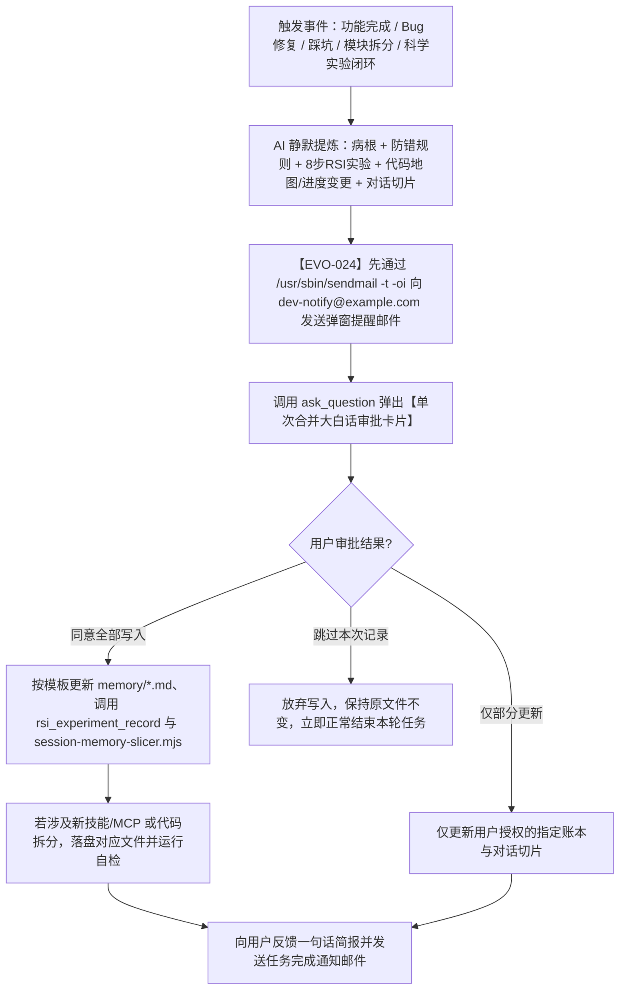

# 全程审批自进化引擎与 Skill / MCP 锻造师 (`self-evolving-skill-mcp-forge`)

本技能定义了 AI 代理如何在项目全生命周期中实现**能力边界扩展（插件检索与工具锻造）**与**免 `/learn` 触发的持续自我进化（活体记忆账本维护 + 3D 知识图谱实时刷新 + Ponytail 可复用轮子库与安全/脱水棘轮更新）**，同时严格遵循**「全程弹窗审批（Approval-Gated）」**铁律，确保面向零基础/非技术背景用户时的绝对透明、可控与零惊吓。

---

## 能力一：插件市场自动检索（Auto-Discover）

当遇到全新技术领域、第三方云服务、外部 SaaS 集成或复杂专业工作流时，**严禁直接硬编码脆弱的临时脚本或盲目声称无法完成**，必须按以下标准顺序执行能力探索：

### 1.1 能力盘点与市场检索三步法
1. **检查已装能力**：首先检视当前会话中已加载的原生工具（Tools）、MCP 服务器（MCP Servers）与技能列表（Skills）。
2. **主动检索插件市场 (`search_marketplace`)**：
   - 若现有工具未覆盖当前需求，立即调用 `search_marketplace` 工具。
   - **查询词构造规范**：单次调用传入 1~3 个简短关键词变体，依次为「产品全称」、「常用缩写」、「核心能力」（例如 `["postgresql", "pg", "database"]` 或 `["stripe", "payment", "billing"]`）。
   - 同时检查 `kind: "all"`（涵盖 `plugin` 与 `skill`）。
3. **向用户推荐或无缝降级**：
   - 若在市场中找到高度匹配的未安装插件/技能：用一句话大白话说明推荐理由，并在独立行输出 `<plugin-card catalog-id="<id>"></plugin-card>` 卡片，引导用户点击安装（严禁代理私自后台安装）；若该插件为任务核心依赖，先行暂停并等待用户决定安装或指示采用替代方案。
   - 若插件已安装但未启用：提示用户在界面中开启，切勿输出重复的 `<plugin-card>`。
   - 若插件市场无匹配项：无缝转入**能力二（自建 Skill 与本地 MCP 锻造器）**。

---

## 能力二：自建 Skill 与本地 MCP 锻造器（Autonomous Skill & MCP Forge）

当插件市场无现成方案，且项目出现**高频重复操作**（累计执行 $\ge 2$ 次，或预判为后续研发/测试/运维的标准动作，如：特定云环境一键预检与部署流、端到端回归测试与截图比对流、特定第三方 API 签名调试流、数据库迁移与脱敏种子数据注入流）时，AI 应当主动提议将其锻造为项目专属的标准化 Skill 或本地 MCP 工具。

### 2.1 项目级 Skill 标准化目录结构与锻造规范
所有自建项目级技能统一存放在项目根目录下的 `.agents/skills/<skill-name>/`（或全局规范目录 `skills/<skill-name>/`）：

```text
.agents/skills/<skill-name>/
├── SKILL.md                # [必填] 核心指令文件（含 YAML frontmatter 与分步执行规程）
├── scripts/                # [推荐] 幂等、自包含的可执行自动化脚本（Python / Bash / Node.js）
│   └── run_workflow.sh
├── examples/               # [可选] 标准输入输出示例与参考实现
└── resources/              # [可选] 模板文件、JSON Schema、静态配置资产
```

#### `SKILL.md` 编写黄金准则：
1. **YAML Frontmatter 必填字段**：
   - `name`: 仅使用小写字母、数字与连字符（如 `api-contract-verifier`）。
   - `description`: 清晰界定**做什么（What）**、**何时触发（When to use）**以及**何时不触发（When NOT to use）**，便于路由引擎精准命中。
2. **指令正文要求**：
   - **前置检查（Pre-flight Checks）**：明确环境变量、依赖项、工作目录与只读/写权限检查。
   - **确定性脚本优先**：将易出错的复杂 Shell 管道、正则解析、API 请求封装进 `scripts/` 下的独立脚本中，脚本必须支持 `--dry-run`（预演模式）、明确的退出码（`0` 成功，非 `0` 失败）以及结构化错误输出。
   - **回滚与清理（Rollback & Cleanup）**：规定执行失败时的现场恢复步骤，严禁残留僵尸进程或半成品临时文件。

### 2.2 本地 MCP Server 锻造与 `.agents/mcp_config.json` 配置规范
当项目需要保持长连接状态、结构化 Schema 强校验调用、或跨会话复用本地工具服务（如本地数据库只读沙盒查询器、内部微服务 Mock 控制器、定制化日志聚合检索器）时，可锻造轻量级本地 MCP Server（基于 Stdio 传输协议）并写入 `.agents/mcp_config.json`。

#### `.agents/mcp_config.json` 标准结构模板：
```json
{
  "mcpServers": {
    "project-custom-toolkit": {
      "command": "node",
      "args": [
        "./.agents/mcp-servers/custom-toolkit/index.mjs"
      ],
      "env": {
        "NODE_ENV": "development",
        "LOG_LEVEL": "info"
      },
      "disabled": false,
      "autoApprove": []
    }
  }
}
```

#### 本地 MCP 锻造铁律：
- **零外部脆弱依赖**：优先使用当前项目已有的运行时（Node.js / Python `uv`）编写单文件无状态或轻量状态 Stdio MCP 服务。
- **严禁硬编码密钥**：任何 API Key、数据库密码必须通过环境变量或运行期安全注入读取，严禁明文写入 `mcp_config.json`。
- **读写分离与安全门禁**：只读查询工具与具有副作用的写入/删除工具必须拆分为独立的 Tool Name，写操作工具必须在描述中标注风险等级。

---

## 能力三：免 `/learn` 的原子级自我学习与「全程审批（Approval-Gated）」进化工作流

### 3.1 自动触发时机（免 `/learn` 被动等待）
AI 代理**严禁等待用户手动输入 `/learn` 命令**才去总结经验。每当发生以下任一关键事件节点时，必须**自动启动自我学习与记忆提炼流水线**：
1. **完成一个功能或里程碑交付**：功能通过真实端到端验证，产品状态发生推进。
2. **修复一个 Bug 或排查完线上/本地故障**：定位到了深层根因并验证修复有效。
3. **踩过一个环境坑、依赖冲突或第三方 API 隐性限制**：在调试过程中走过弯路并找到了正确解法。
4. **新增、拆分或重构了代码模块**：遵循乐高模块化原则修改了文件结构、核心函数签名或行号区间。
5. **完成了多方案联网调研对比或重大架构选型**：通过子代理调研与沙盒实测得出了选型结论。
6. **识别到高频重复痛点，准备新建/升级项目专属 Skill 或 MCP 工具**。

### 3.2 后台自动提炼的五大核心要素
在触发节点达成后，AI 先在内存中静默提炼以下结构化进化补丁（Delta Patch）：
- **病根（Root Cause）**：剥离表面报错，直击架构缺陷、状态不同步、边界条件遗漏或环境配置缺失的本质原因。
- **触发条件（Trigger Condition）**：明确在什么操作、什么输入特征或什么环境变更下会复现该问题。
- **原子级防复发规则（Atomic Prevention Rule）**：提炼为一句可执行、可验证的“如果……必须……严禁……”硬性检查铁律，并指明应注入到哪个门禁脚本或哪个 `SKILL.md` 中。
- **代码地图变更（Code Map Delta）**：新增/修改/拆分的文件路径、模块职责、核心函数行号区间及依赖方向变化。
- **产品进度变更（Product Progress Delta）**：当前完成的功能点、验收证据摘要及下一步待办事项状态流转。
- **单次对话上下文切片（Session Context Slice）**：本轮对话中用户的原话意图、审美/交互偏好、**明确否决过的方案（“别再问清单”）**、推理脉络以及跨窗口 10 秒无缝交接胶囊。

---

## 核心硬约束：全程弹窗审批模式（Approval-Gated Evolution Protocol）

> [!IMPORTANT]
> **最高优先级铁律（违者视为严重违规）**：
> 在执行以下任何持久化变更动作之前——
> 1. 向 `memory/PRODUCT_PROGRESS.md`、`memory/CODE_MAP.md`、`memory/EVOLUTION_LEDGER.md`、`memory/ARCHITECTURE_DECISIONS.md`、`memory/CONVERSATION_INDEX.md` 及 `memory/sessions/*.md` 写入或追加内容；
> 2. 修改全局宪法 `GEMINI.md`；
> 3. 对现有大文件执行物理拆分重构；
> 4. 创建或修改 `.agents/skills/` 下的自建技能或 `.agents/mcp_config.json` 配置；
>
> **AI 必须无条件先通过 `/usr/sbin/sendmail -t -oi` 向 `dev-notify@example.com` 发送提醒邮件（`EVO-024` 铁律：写明哪个项目/对话弹出了什么问题与选项），紧接着调用 `ask_question` 工具弹窗，向用户展示通俗易懂的「大白话审批卡片」！** 只有在用户明确选择**“同意写入 / 同意执行”**后，才允许调用 `write_file`、`edit_file` 或切片脚本落盘！

### 4.1 为什么必须采用「弹窗前先发邮件（`EVO-024`）」、「大白话审批卡片」、「A/B 类文件无冲突分流」与「单次合并弹窗防打转协议」（`EVO-006` & `EVO-016`）？
- **弹窗前先发邮件防挂起（`EVO-024`）**：用户可能在床上休息或离开电脑屏幕，调用 `ask_question` 会同步阻塞等待点击，因此每次调用 `ask_question` 前必须先通过 `/usr/sbin/sendmail -t -oi` 发送邮件通知 `dev-notify@example.com`，让用户在手机上收到提醒后回电脑前拍板。
- **长篇方案与弹窗提问分步解耦防遮挡（`EVO-028`）**：详尽方案必须先在正文或独立 Artifact 中完整平铺输出，严禁与长篇核心方案同一回合并发调用 `ask_question`，避免 UI 模态选择卡片遮挡正文视线导致用户“看不到方案”；弹窗问题与选项本身必须自包含核心要点摘要。
- **保护小白用户掌控感**：避免 AI 在后台静默修改规则、记忆库或代码结构导致项目行为突变而用户毫不知情。
- **防止垃圾记忆污染**：确保写入 `EVOLUTION_LEDGER.md` 和 `GEMINI.md` 的每一条防错铁律都经过人类意图确认，保持记忆库的高信噪比。
- **A 类人类语义账本 vs B 类机器派生视图严格分流（`EVO-016` 零自冲突准则）**：
  - **A 类人类语义账本**（`PRODUCT_PROGRESS.md`、`CODE_MAP.md`、`EVOLUTION_LEDGER.md`、`ARCHITECTURE_DECISIONS.md`、`CONVERSATION_INDEX.md`、`memory/sessions/*.md`）：修改前必须经过下方单次合并 `ask_question` 审批（**特例：L1 轻量级只读问答/纯文案样式微调任务免弹窗**）；
  - **B 类机器派生图谱、棘轮与蜂群注册表**（`memory/.memory-store/memory.sqlite`、`memory/.memory-store/evolution-metrics.json`、`memory/CODE_GRAPH_3D.html`、`memory/GRAPH_REPORT.md`、`memory/CODE_GRAPH_FEDERATED_3D.html`、`memory/FEDERATED_GRAPH_REPORT.md`、`memory/CROSS_INBOX.md`、`~/.gemini/antigravity/plugin_data/agy-evo-os/swarm-registry.json`）：随代码变更、工具调用与 `stop-hook-guardian.mjs` 收工钩子**全自动静默编译刷新，严禁为 B 类派生文件弹窗打断用户**！
- **防连环弹窗与防内部原地打转铁律**：
  1. **收工前单次合并审批（Single-Batch Approval）**：严禁为 `PRODUCT_PROGRESS.md`、`CODE_MAP.md`、`EVOLUTION_LEDGER.md`、`ARCHITECTURE_DECISIONS.md`、`CONVERSATION_INDEX.md` 分别弹出多次独立窗口！必须在通过 `GATE-01 ~ GATE-06` 实测后，将所有待更新账本、本次对话上下文切片与拟新建 Skill/MCP **汇总进下方同一个 `ask_question` 弹窗**中一次性请用户拍板。
  2. **用户跳过即合法完结（Veto Exemption）**：一旦用户选择 `"跳过本次记录，不做任何记忆库文件修改"`，AI 必须立即尊重用户决定并直接输出最终交付报告结束本轮对话，**绝对禁止因“账本未更新”而在内部反复重试或再次弹窗**！

### 4.2 `ask_question` 审批卡片标准构造模板
调用 `ask_question` 时，禁止使用晦涩的技术黑话，必须包含**「本次准备做什么」**、**「为什么要这么做（对你的好处）」**与**「将影响哪些文件」**三部分：

```json
{
  "questions": [
    {
      "question": "【自进化记忆与对话上下文切片审批】刚才我们解决了「XXX问题 / 完成了XXX功能」。为了防止以后再踩同样的坑、并让你下次新开对话窗口时能1秒无缝接上进度，我准备执行以下更新：\n1. 记入错题本 (memory/EVOLUTION_LEDGER.md)：记录「遇到A情况时必须先检查B」的防错铁律或 8 步科学实验闭环 [RSI-xxx]；\n2. 更新代码地图 (memory/CODE_MAP.md) 与产品进度 (memory/PRODUCT_PROGRESS.md)：同步最新模块行号与已完成状态；\n3. 生成本次对话专属上下文切片 (memory/sessions/CONV-xxx.md) 并更新总目录 (memory/CONVERSATION_INDEX.md)：沉淀你的偏好、明确否决过的方案与下一步交接点；\n4. [可选] 新建自动化技能 (.agents/skills/xxx/SKILL.md)：把刚才繁琐的检查打包成一键工具。\n请问是否允许我将以上内容写入项目记忆库？",
      "options": [
        "(Recommended) 同意全部写入：更新记忆账本、对话切片并保存防错经验",
        "仅更新产品进度、代码地图与对话切片，暂不写入错题本或新建技能",
        "跳过本次记录，不做任何记忆库文件修改"
      ],
      "is_multi_select": false
    }
  ]
}
```

### 4.3 审批后标准落盘与闭环流程


---

## 能力四：双轨自进化机制——「被动防御铠甲 + 主动 8 步科学实验闭环与研发劳动力倍增飞轮」（`EVO-025`）

智能体的自进化不仅包括踩坑后的防复发兜底，更必须具备**主动科学实验、持续将人工操作铸造为自动化生产力资产**的能力：

### 5.1 双轨自进化对照表
| 进化轨道 | 触发驱动 | 落盘载体与工具 | 核心产出 |
| :--- | :--- | :--- | :--- |
| **轨迹 1：被动防御型进化（摔一跤，长一层铠甲）** | 报错排查、用户纠偏、线上故障、边界遗漏 | `EVOLUTION_LEDGER.md` (`[EVO-xxx]`) + 门禁脚本断言 | 确定性拦截同类低级错误，实现历史同源故障复发率 `= 0` |
| **轨迹 2：主动科学实验与生产力倍增飞轮（8 步 RSI 闭环）** | 针对**用户习惯、插件/Skill 工具、项目代码架构、蜂群协同流**的效率瓶颈主动攻坚 | MCP `rsi_experiment_record` -> `EVOLUTION_LEDGER.md` (`[RSI-xxx]`) + `evolution-metrics.json` | 沉淀可复用轮子、自动化脚本、MCP 工具与领域工作会话，持续推高**研发劳动力倍增系数 (`laborForceMultiplier`)** |

### 5.2 8 步科学实验闭环标准规程（Scientific RSI 8-Step Loop）
凡执行主动优化、工具链升级或架构演进实验，必须完整走通并调用 MCP `rsi_experiment_record` 记录以下 8 步闭环：
1. **Step 1 提出假设 (`step1_hypothesis`)**：明确指出针对哪个域（`USER_HABIT` / `PLUGIN_OR_SKILL` / `CODE_ARCHITECTURE` / `SWARM_WORKFLOW`）的痛点，提出可证伪的量化改进假设。
2. **Step 2 设计实验 (`step2_experiment_design`)**：设计基准对照组（Baseline）与实验组验证方案、极端边界测试用例与成功判定阈值。
3. **Step 3 修改代码与固化工具 (`step3_code_changes`)**：实施乐高式代码改动，并将人工重复动作封装为可复用函数、自动化脚本、Skill 或 MCP 工具。
4. **Step 4 启动实验 (`step4_experiment_run`)**：在沙盒或真机环境运行自动化门禁、端到端测试与并发压力验证。
5. **Step 5 分析实验结果 (`step5_result_analysis`)**：对比实验前后耗时、Token 消耗、错误率、代码体积与门禁通过率数据。
6. **Step 6 诊断失败原因或边界缺陷 (`step6_failure_diagnosis`)**：诚实剖析实验中暴露的失败分支、死锁隐患或边缘局限（严禁报喜不报忧）。
7. **Step 7 调整实验路线 (`step7_route_adjustment`)**：根据诊断结论修正代码逻辑、增加豁免通道或降级兜底策略，并完成回归验证。
8. **Step 8 开启下一轮迭代与铸造劳动力资产 (`step8_next_cycle_and_labor_minted`)**：清单化登记本次实验新铸造的**永久性研发劳动力资产**，并提出下一轮迭代假设。

### 5.3 研发劳动力倍增棘轮公式（R&D Labor Force Multiplier）
`security-and-simplicity-audit.mjs` 在每次审计与收工时自动扫描项目资产并写入 `memory/.memory-store/evolution-metrics.json` 的 `currentSnapshot.laborForceMetrics`：
$$\text{laborForceMultiplier} = \text{round}\big(1 + 0.05 \times N_{\text{wheels}} + 0.35 \times N_{\text{scripts}} + 0.50 \times N_{\text{mcp\_skills}} + 1.20 \times N_{\text{specialists}} + 0.25 \times N_{\text{rsi}}, 2\big)$$

---

## 能力五：AGY Swarm Commander 蜂群指挥官体系（`1 总控 + N 具名板块子对话窗口 + M 会话内子代理` · `EVO-026`）

当面对跨多端、多仓库或大型复杂项目（如「前端工坊 + 主后端工作台 + AcmeMedia 视频网关 + EdgeNode 边缘板卡」）时，单对话上下文极易被撑爆，必须启用 **三层蜂群指挥官架构**：

### 6.1 三层蜂群职责边界与具名角色板块矩阵（`EVO-027`）
1. **`1` 总控调度器窗口（Swarm Commander）**：
   - **最高战略中枢与验收大脑**：负责理解用户全局战略意图、拆解跨板块契约、调用 `swarm_status_board` 巡视全局态势、调用 `swarm_spawn_or_route_by_name` 指派具名领域工作会话推进，并汇总工作节点任务回执向用户做最终汇报。
   - **总控中枢定位铁律（Brain-as-Commander Guardrail）**：**严禁总控在主窗口大包大揽“库库自己干”导致单对话膨胀至数万步！** 复合型需求、跨端业务或深层编码必须按板块拆解下发，总控只把控架构设计、契约定义与最终验收。
2. **`N` 个具名板块子对话窗口（Named Module Specialists，`🧩 [板块:<名称>] 工作节点`）**：每个窗口长期深耕单一业务项目目录（`project_root`），拥有独立的持久化对话历史与项目级 `memory/`；通过 `swarm_spawn_or_route_by_name` 按板块名精准路由唤醒（若不存在且 `auto_create_if_missing: true`，自动通过 LanguageServer `StartCascade` + `UpdateConversationAnnotations` 孵化并记入 `~/.gemini/antigravity/plugin_data/agy-evo-os/swarm-registry.json`）。
   - **五大标准业务领域工作会话矩阵**：
     - `MOBILE_EDGE_CTRL`（移动端与安卓云手机操控领域工作会话：ADB、Scrcpy、多分辨率触控、TikTok/应用自动化、硬件板卡通讯）
     - `CLOUD_QUOTA_REVERSE`（云端多算力与逆向协议领域工作会话：Google Flow / aisandbox / Colab / 逆向 API / 免密免算力通道 / 纯 HTTP 客户端）
     - `MEDIA_VIDEO_AUDIO`（音视频生成与多模态合成领域工作会话：Veo / ComfyUI / FFmpeg 音频混流 / 情绪配音 / 音乐对齐 / 多模态视觉）
     - `FRONTEND_STUDIO_SSOT`（前端交互与 3D 星系可视化领域工作会话：Next.js / React / 3D 图谱 / WebGL / 数据大屏 / 响应式 UI）
     - `BACKEND_WORKBENCH_CORE`（主后端与本地工作台业务工作节点：FastAPI / SQLite / 契约分发 / 本地文件与配置）
3. **`M` 个会话内子代理（In-Session Subagents）**：在总控或任一领域工作会话窗口内部，通过并发子代理执行短平快的代码探查、联网科研、红蓝对抗测试，委派时必须显式指定其具体的任务板块角色属性（Role），用完即焚、零跨窗口污染。

### 6.2 `SWARM_ACK` 工作节点异步回传防死锁特权铁律
领域工作会话完成任务、受阻（`BLOCKED`）或需要总控拍板（`NEEDS_DECISION`）时，**严禁调用普通 `cross_conversation_dispatch` 反向派单总控**（因总控常挂载在父级容器目录且与工作节点构成双向通信，会被普通派单的容器写保护、Gate 2 乒乓锁、Gate 3 冷却锁与 Gate 4 空闲锁拦截导致死锁），**必须调用专属特权工具 `swarm_report_to_commander`**：
- 自动豁免父级容器目录写拦截，直接将结构化任务回执写入全局 `~/.gemini/antigravity/plugin_data/agy-evo-os/swarm-registry.json` 的 `commanderReports` 队列；
- 自动豁免 Gate 2（Ping-Pong 反向拦截）、Gate 3（60s 冷却）与 Gate 4（仅限 IDLE 态），通过 `SendAgentMessage` 将任务回执实时推送至总控对话窗口。

### 6.3 跨项目收件箱派单核销原子工具化与任务回执自动核销（`EVO-029`）
- **核销工具原生化**：工作节点处理完毕收件箱派单时，严禁使用带长标题的文本块手工调用 `edit_file`；必须优先调用原生 MCP 工具 `cross_inbox_ack`（指定 `project_root` 与 `xmsg_id`），直接原子级将 `CROSS_INBOX.md` 中的状态由 `PENDING` 置为 `ACKED`，并自动刷新 SQLite 增量索引；
- **任务回执一站式自动核销闭环**：工作节点调用 `swarm_report_to_commander` 向总控回传任务回执时，系统底层自动从任务回执标题、战果摘要与验证证据中通过正则扫描匹配出所有的 `XMSG-[A-Z0-9]{8,12}` 派单标识，并在工作节点本地收件箱中自动完成 `STATUS: ACKED` 核销，零手动改码、零正则失配！

---

## 六大活体记忆库联动维护准则（含「按对话拆分 + 两级懒加载」机制）

1. **`memory/PRODUCT_PROGRESS.md`（产品全景进度账本）**：每次功能验收通过后更新里程碑百分比、验收状态矩阵与版本记录，确保随时打开都能看清“现在在哪、还差什么才能上线”。
2. **`memory/CODE_MAP.md`（乐高模块级全局代码地图）**：每次新增文件、修改核心函数或拆分模块后，通过 `node scripts/auto-code-mapper.mjs --output memory/CODE_MAP.md` 局部刷新行号区间索引及待拆分大文件追踪表，严禁出现“有代码无地图”。
3. **`memory/EVOLUTION_LEDGER.md`（原子级错题本、8 步科学实验闭环与自我进化基因库）**：既记录被动防复发基因（`[EVO-xxx]`），也通过 `rsi_experiment_record` 记录主动 8 步科学实验闭环（`[RSI-xxx]`），同时将提炼出的防错动作与自动化工具反向注入到 `SKILL.md` 或门禁脚本中。
4. **`memory/ARCHITECTURE_DECISIONS.md`（架构决策与联网调研档案 ADR）**：每次通过并行子代理完成联网方案对比与沙盒实测后，将候选方案优劣表、实测数据与最终选型理由归档备查，杜绝凭印象拍脑袋做架构改动。
5. **`memory/CONVERSATION_INDEX.md` + `memory/sessions/CONV-xxx.md` + `memory/CROSS_INBOX.md`（按对话拆分的上下文记忆总目录、独立切片库与跨项目收件箱）**：
   - **写入方式**：获批后运行 `node scripts/session-memory-slicer.mjs --topic "..." --intent "..." --vetoed "..." --modules "..." --snapshot "..." --next "..."`，自动在 `memory/sessions/` 下生成按对话拆分的独立切片文件，并自动刷新 `CONVERSATION_INDEX.md` 的总表与顶部「跨窗口无缝交接胶囊」。
   - **读取方式（两级懒加载防爆 Token）**：新开对话时，AI **仅读取 `memory/CONVERSATION_INDEX.md` + 最新 1 个对话切片 + `CROSS_INBOX.md` 未读项**即可恢复全部上下文；绝不一次性全量读取所有历史切片，仅在涉及特定历史模块时按索引按需点读。
